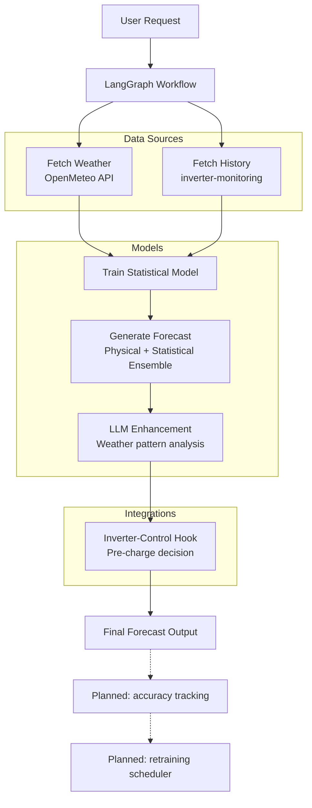
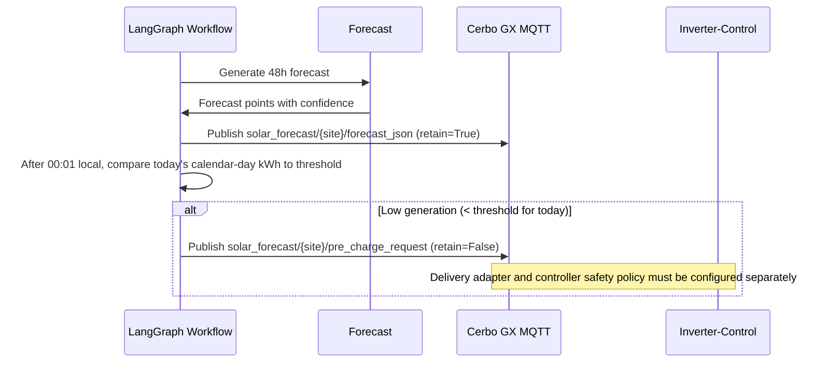

# Solar Forecast LangGraph

[](https://github.com/4alvit/solar-forecast-langgraph/actions/workflows/quality-gate.yml)
[](https://codecov.io/gh/4alvit/solar-forecast-langgraph)
[](https://pypi.org/project/solar-forecast-langgraph/)
[](https://pypi.org/project/solar-forecast-langgraph/)
[](LICENSE)

LangGraph workflow for solar forecasting with:
- **Weather data agent** — OpenMeteo API (free, no key required)
- **Historical generation loader** — From inverter-monitoring webhook
- **Panel configuration schema** — Azimuth, tilt, capacity, losses
- **Forecast model** — Physical (clear-sky + clouds) + Statistical (ML) + LLM reasoning
- **Inverter-control integration** — Pre-charge battery before cloudy periods
- **Forecast validation** — Evaluation requirements and current limitations ([guide](docs/forecast-validation.md))

---

<!-- ci-release-process:start -->
## Release process

See the [release strategy](RELEASING.md) for validation, nightly, beta, RC and stable promotion rules, and the [operator runbook](docs/release-workflow.md) for local commands.
<!-- ci-release-process:end -->

## Architecture



---

## Installation

### From a stable GitHub release

[GitHub Releases](https://github.com/4alvit/solar-forecast-langgraph/releases) is the
current release channel. As of 12 October 2026, GitHub stable is `v0.1.4`, while
[PyPI](https://pypi.org/project/solar-forecast-langgraph/) still serves `0.1.2`.
An unqualified `pip install solar-forecast-langgraph` therefore does not install
the current GitHub release.

```bash
python -m venv .venv
source .venv/bin/activate  # Windows: .venv\Scripts\activate
python -m pip install "https://github.com/4alvit/solar-forecast-langgraph/releases/download/v0.1.4/solar_forecast_langgraph-0.1.4-py3-none-any.whl"
```

Select an explicit stable tag and verify its `SHA256SUMS` and
`release-manifest.json` when updating. Nightly, beta and RC tags are prereleases.
PyPI publication is a separate verified-asset promotion; it is not triggered by
creating a GitHub release. See [distribution channels](docs/distribution-channels.md).

After installing, check the CLI is available:

```bash
solar-forecast --help
```

### From source (for development)

```bash
git clone git@github.com:4alvit/solar-forecast-langgraph.git
cd solar-forecast-langgraph
python -m venv .venv
source .venv/bin/activate
pip install -e ".[dev]"
pre-commit install
```

---

## Quick Start

```bash
# Copy example config and customize
cp site_config.example.py site_config.local.py
# Edit site_config.local.py with your panel details

# Run forecast (48h horizon, 30 days history)
solar-forecast --config site_config.local.py --horizon 48 --output forecast.json
```

Output example:
```
Forecast Summary:
  Site: my-solar-site
  Panel: south-roof
  Method: ensemble
  Horizon: 48 hours
  Total Energy: 42500 Wh
  Generated: 2024-01-15T10:30:00+00:00

Next 12 hours:
  2024-01-15 11:00: 1200W (1200Wh) [960-1440]
  2024-01-15 12:00: 2800W (2800Wh) [2240-3360]
  2024-01-15 13:00: 3500W (3500Wh) [2800-4200]
```

---

## Configuration

### Panel Configuration

```python
from solar_forecast.config import PanelConfig, SiteConfig

panel = PanelConfig(
    name="South Roof",
    panel_id="south-roof",
    azimuth=180,  # 0=N, 90=E, 180=S, 270=W
    tilt=35,  # Degrees from horizontal
    capacity_kw=5.0,  # DC capacity
    module_count=14,
    latitude=52.37,
    longitude=4.90,
    # Optional losses
    shading_loss=0.0,
    soiling_loss=0.02,
    wiring_loss=0.01,
    module_efficiency=0.20,
    temperature_coefficient=-0.0035,
    inverter_efficiency=0.96,
    dc_ac_ratio=1.2,
)

site = SiteConfig(
    site_name="my-site",
    latitude=52.37,
    longitude=4.90,
    timezone="Europe/Amsterdam",
    panels=[panel],
)
```

See [site_config.example.py](site_config.example.py) for full example.

---

## Forecast Methods

| Method | Description | Use Case |
|--------|-------------|----------|
| `physical` | Clear-sky model + cloud adjustment | No historical data |
| `statistical` | ML model on historical data | Sufficient history (30+ days) |
| `ensemble` | Weighted: 60% physical + 40% statistical | Default; comparative accuracy is not yet established |
| `llm_enhanced` | LLM analyzes weather patterns | Future: complex weather |

---

## Inverter-Control Integration

The workflow publishes forecast data and pre-charge requests to the Cerbo GX MQTT broker (Venus OS `N/` namespace):



Topics published:

The workflow suppresses pre-charge when there are no points for the panel's
current local calendar day; it still publishes the available daily summary.
A present zero-generation forecast remains distinct from missing data. MQTT
publication alone does not prove controller delivery or physical charging.
Repeated workflow runs can publish repeated requests: the integration must
establish deduplication and an actuator-side safety gate before enabling
automatic charging. This workflow does not provide that end-to-end guarantee.

| Topic | retain | Payload |
|-------|--------|---------|
| `solar_forecast/{site_id}/forecast_json` | True | Daily kWh summary (`today_kwh`, `tomorrow_kwh`) |
| `solar_forecast/{site_id}/pre_charge_request` | False | Pre-charge trigger for low **today** forecast (`horizon_hours=24`, `day=today`) |

Environment variables:
```bash
INVERTER_CONTROL_ENABLED=true          # Enable the hook
MQTT_BROKER=localhost                # Cerbo GX MQTT broker host
MQTT_PORT=1883                       # MQTT port
SITE_ID=default                      # Site identifier used in topic paths
PRE_CHARGE_THRESHOLD_WH=6000         # Pre-charge if today's calendar-day forecast < this (Wh)
TOU_EXPENSIVE_START_HOUR=22          # Optional: suppress pre-charge during expensive grid window
TOU_EXPENSIVE_END_HOUR=6
```

The expensive tariff window uses the selected panel's `timezone`, including its
daylight-saving rules. The container's `TZ` does not change this decision. Start
hours are inclusive and end hours are exclusive; `22` to `6` spans midnight, and
an end hour of `24` ends at midnight. For example, a panel in `Europe/Amsterdam`
suppresses pre-charge from 22:00 to 06:00 Amsterdam time even when the container
runs in UTC. Forecast publication continues while pre-charge is suppressed.

---

## Forecast Validation

The implementation trains from historical generation and produces forecasts.
It does not yet persist forecast-versus-actual pairs, calculate operational
MAE/RMSE/MAPE/bias, or automatically retrain based on measured errors. Unit tests
use synthetic weather/generation and check behavior; they are not evidence of
accuracy on a real installation.

See [forecast validation](docs/forecast-validation.md) for the required public
data, chronological holdout, baselines, and metrics before claiming that one
method is more accurate or using forecasts for operational decisions.

---

## Development

### Run Tests

```bash
pytest tests/ -v --cov=solar_forecast
```

### Lint & Format

```bash
ruff check .
ruff format .
```

### Type Check

```bash
mypy solar_forecast/
```

---

## Project Structure

```
solar-forecast-langgraph/
├── solar_forecast/
│   ├── __init__.py          # Public exports
│   ├── config.py            # Panel/Site configuration schemas
│   ├── weather.py           # OpenMeteo client
│   ├── history.py           # Historical data loaders
│   ├── model.py             # Physical/Statistical/LLM models
│   ├── workflow.py          # LangGraph workflow
│   └── main.py              # CLI entry point
├── tests/
│   ├── test_config.py
│   ├── test_weather.py
│   ├── test_model.py
│   └── test_workflow.py
├── .github/workflows/ci-checks.yml # Reusable CI checks
├── pyproject.toml           # Package config
├── site_config.example.py   # Example configuration
└── README.md
```

---

## Roadmap

- [ ] LLM-enhanced forecasting (weather pattern analysis)
- [ ] Automated model retraining scheduler
- [ ] Prometheus metrics export
- [ ] Grafana dashboard template
- [ ] Multi-site support in single workflow
- [ ] Battery SoC optimization (not just pre-charge)
- [ ] Shadow modeling from 3D terrain

---

## Docker

The release pipeline builds `linux/amd64` and `linux/arm64` OCI artifacts and
attaches them to GitHub releases. Publishing those verified bytes to GHCR is a
separate explicit operation; pushes to `main` and prereleases do not deploy a
container or move `latest`.

Before configuring Docker or Portainer, verify that the intended stable version
has been published to `ghcr.io/4alvit/solar-forecast-langgraph`, then pin its image
digest. The [distribution runbook](docs/distribution-channels.md) describes the
verification and publication boundary.

## Related Projects

- **[inverter-monitoring](https://github.com/victron-venus/inverter-monitoring)** — Generation data webhook
- **[inverter-control](https://github.com/victron-venus/inverter-control)** — Grid-zero feed-in control

---

## License

MIT License — see [LICENSE](LICENSE) for details.

## Contributing and security

See [CONTRIBUTING.md](CONTRIBUTING.md) for development, bug reports and proposals,
[SECURITY.md](SECURITY.md) for confidential vulnerability reports and deployment
boundaries, and the [OpenSSF evidence index](docs/openssf-evidence.md) for assessment
scope and verification.

HTTPS transport and runtime requirements are described in [TLS policy](docs/tls-policy.md).
